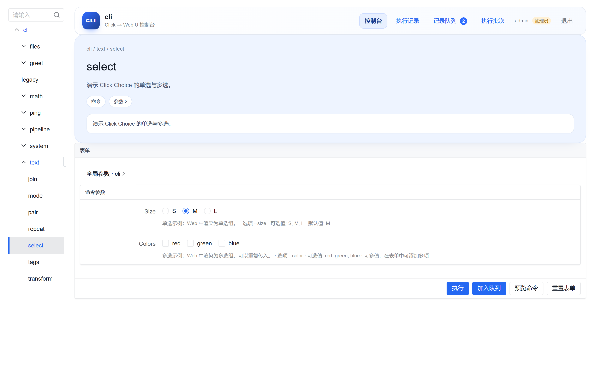
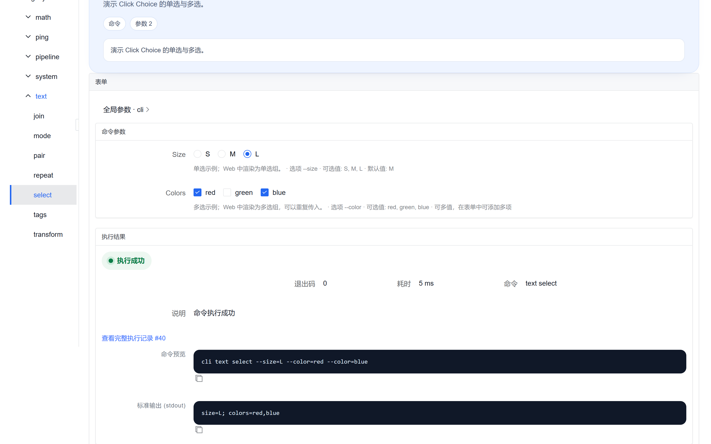
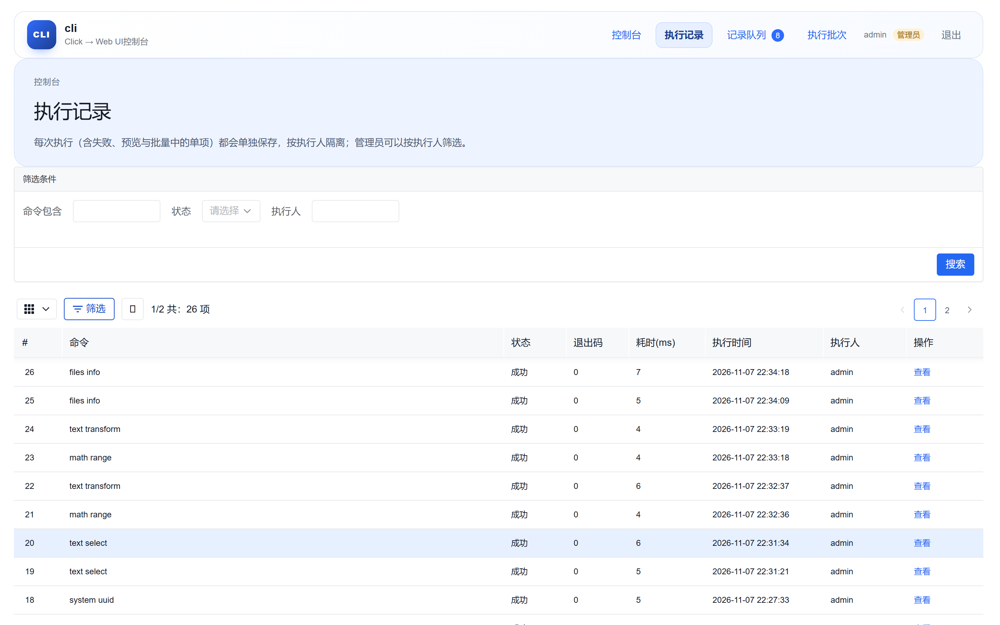
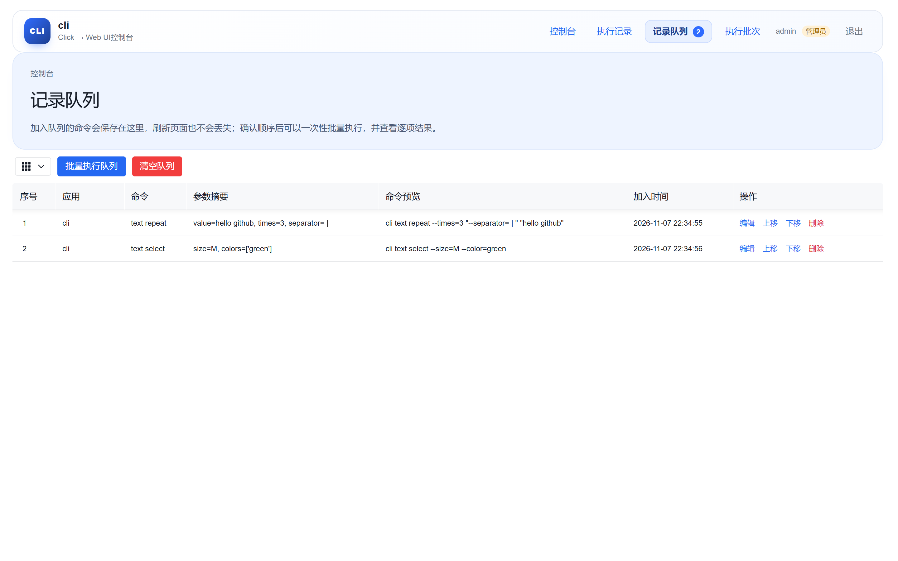
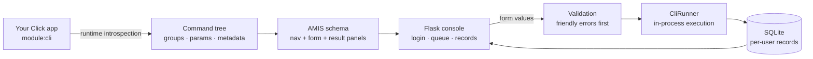

# click-ui

**中文文档:** [README.zh-CN.md](README.zh-CN.md)

**Turn any Click CLI into a polished web console — without touching a line of Click code.**

[](https://www.python.org/)
[](https://click.palletsprojects.com/)
[](https://amis.baidu.com/)
[](https://flask.palletsprojects.com/)
[](LICENSE)

`click-ui` introspects a normal Click application at runtime and renders it as an
[AMIS](https://amis.baidu.com/) console: a navigation tree for your command groups, a real
form for every argument and option, execution records per operator, a queue for batch-running
commands, and cross-platform cron / one-off scheduling.

```bash
# from the repository root
pip install -e .
cliui serve examples/demo_cli.py:cli
```

That is the whole integration. Your Click app keeps working exactly as before:

```bash
python examples/demo_cli.py text transform "hello world"
```



---

## Table of contents

- [Why click-ui](#why-click-ui)
- [Features](#features)
- [Quick start](#quick-start)
- [Screenshots](#screenshots)
- [How it works](#how-it-works)
- [Click coverage](#click-coverage)
- [Configuration](#configuration)
- [CLI reference](#cli-reference)
- [Examples](#examples)
- [Security notes](#security-notes)
- [Development](#development)
- [License](#license)

---

## Why click-ui

Internal CLIs are usually the fastest way to ship an operation — and the least accessible one.
Operators, QA, support engineers and product managers cannot run `--region prod --dry-run`
from a terminal, and wrapping every script in yet another bespoke admin page does not scale.

`click-ui` takes the CLI you already have and gives it a web UI:

- **Nothing to rewrite.** No decorators, no registration, no `click` subclass. The console reads
  `click.Command` / `Group` / `CommandCollection` objects at startup.
- **Nothing to design.** Forms, labels, help text, defaults and validators are generated from
  Click metadata, so the UI never drifts from the CLI.
- **Nothing to build.** Flask serves the page and the AMIS SDK is bundled locally, so the console
  runs offline and on an intranet with no CDN access.

## Features

**A faithful console for your command tree**

- Navigation tree generated from nested `click.Group`s — including lazy groups, chained groups,
  `CommandCollection` sources and deprecated commands (hidden commands are loaded but kept out
  of the tree).
- One form per command, built from real Click parameters: arguments, options, defaults,
  `required`, `metavar`, `help`, `show_default`, `envvar`, `prompt`, `hidden`, `deprecated`.
- Command preview before anything runs: the exact argv is shown, quoted the way Click will see it.
- Global options are separated from command options, so inherited group parameters are obvious.

**Parameter types rendered as the right control**

| Click construct | Console widget |
| --- | --- |
| `str` / untyped argument | Text input |
| `int`, `float` | Number input |
| `click.IntRange` / `click.FloatRange` | Number input with `min` / `max` |
| `--flag/--no-flag`, `is_flag` | Switch |
| Count flags (`-v`, `-vv`) | Number input (`min=0`) |
| `click.Choice` | Radio group |
| `click.Choice(multiple=True)` | Checkbox group |
| `multiple=True`, `nargs>1`, `nargs=-1` | Add/remove array editor (with min/max length for fixed arity) |
| `click.Tuple` | Array editor |
| `click.DateTime` | Date-time picker |
| `click.UUID` | Text input with live UUID validation |
| `click.File(mode="r")` | File upload (bounds-checked server-side) |
| `click.File(mode="w")` | Output path input |
| `click.Path` | Path input with optional upload helper |
| Option with `hide_input=True` | Masked password input |

**Execution you can audit**

- Every run is stored in SQLite with operator, command, argv, exit code, duration, stdout,
  stderr and exception text.
- Records are isolated per operator; administrators can filter and inspect all of them.
- Failed runs, previews and every item of a batch are recorded separately.

**Queue and batch execution**

- Click **Add to queue** instead of **Run**, reorder items, then execute the whole queue in one
  batch and read per-item results.
- The queue survives page reloads because it lives in the database, not the browser.
- Every batch is stored as its own batch record with per-item status, history and output.

**Scheduled execution**

- Fill in the **Schedule settings** panel on any command form: a 5-field cron expression or a
  one-off time, then press **Add schedule**. IANA time zones (default `Asia/Shanghai`), cron
  presets and a preview of the next three fires are included.
- Run the scheduler as a standalone process (`cliui scheduler --data-dir data`) in production,
  or in-process with `cliui serve --scheduler` during development. Both share one code path and
  the same SQLite database.
- Fires missed while the scheduler was down are marked `missed`; each schedule can opt into a
  single catch-up run.
- Each fire is claimed atomically in SQLite, so multiple processes never run the same slot twice.
  Records are tagged with source `schedule` and link back to their schedule.
- Regular users manage only their own schedules; administrators can see every schedule.

**Command overview**

- `/overview` lists every command across all registered apps with a one-line summary. Clicking a
  command opens its form directly.
- Clicking the **CLI** badge in the top-left corner returns to the overview at any time.

**Multi-app, multi-user**

- Serve several Click applications side by side with `name=module:cli` specs.
- Session login with PBKDF2-hashed passwords, admin and regular roles, and a `cliui user` CLI
  for account management.
- Flask secret keys are generated and persisted on first start; session cookies never reuse a
  hard-coded key.

**Bounded by design**

- Rule-based validation runs before Click, and Click's own validation runs before execution.
- Output is capped (`--max-output-chars`), uploads are capped (`--max-upload-mb`), and the
  executor runs in-process so no shell injection surface is added.

## Quick start

Requirements: Python 3.9+, Click 8.1+, Flask 3, APScheduler 3.10+ (Windows time zones come from
the `tzdata` dependency).

```bash
# 1. install from the repository root
pip install -e .

# 2. serve the bundled demo CLI
cliui serve examples/demo_cli.py:cli

# 3. open http://127.0.0.1:5000
```

On the first start the console creates an `admin` account and prints its password. To choose
one explicitly:

```bash
cliui serve examples/demo_cli.py:cli --admin-password admin123 --open
```

Want to start with your own app? Point at any importable Click object:

```bash
cliui serve mypackage.cli:cli
cliui serve path/to/script.py:cli
cliui serve tools/admin_cli.py:cli name=worker=tools/worker_cli.py:cli
```

A 30-line example lives in [`examples/minimal_cli.py`](examples/minimal_cli.py):

```bash
cliui serve examples/minimal_cli.py:cli
```

More detail: [docs/quickstart.md](docs/quickstart.md).

## Screenshots

| Command form | Preview and execution |
| --- | --- |
|  |  |

| Execution records | Queue for batch execution |
| --- | --- |
|  |  |

## How it works



1. **Introspection** walks the Click command tree without executing it, collecting command
   paths, help text, parameter types, defaults, choices and flags.
2. **Schema generation** converts that tree into AMIS JSON: navigation, one form per command,
   result panels and record tables. No client-side schema logic is needed.
3. **Validation** translates form values into Click-style argv and validates them *before*
   execution, returning field-level messages in the form itself.
4. **Execution** runs the command in-process with Click's `CliRunner`, capturing stdout,
   stderr, exit code and duration.
5. **Storage** keeps users, execution records, queue items and batches in SQLite under the data
   directory, isolated per operator.

Read the design notes in [docs/architecture.md](docs/architecture.md).

## Click coverage

- `click.Command`, `click.Group`, nested groups, `invoke_without_command`
- `click.CommandCollection` with multiple sources
- Custom groups that override `list_commands` / `get_command` (including lazy loading)
- `chain=True` command groups (flagged in the UI; recommended to batch through the queue)
- `deprecated=True` and `hidden=True` commands (the latter are loaded but not navigable)
- `allow_extra_args` commands (flagged, since the form can only expose declared parameters)
- `context_settings` help aliases such as `-h/--help`
- Parameters created by `click.option`, `click.argument`, `click.password_option`
- `multiple`, `nargs`, `Tuple`, `Choice`, `DateTime`, `UUID`, `File`, `Path`, ranges, count flags
- `envvar`, `prompt`, `hide_input`, `is_eager`

## Configuration

### `cliui serve`

| Flag | Default | Description |
| --- | --- | --- |
| `SPEC...` | required | One or more `module:attr` / `file.py:attr` specs, optionally `name=spec` |
| `--host` | `127.0.0.1` | Listen address |
| `--port` | `5000` | Listen port |
| `--data-dir` | `./data` | SQLite database, uploads and secret key |
| `--db-path` | `<data-dir>/cliui.sqlite3` | Override the SQLite file |
| `--secret-key` | generated | Flask session signing key |
| `--admin-password` | generated | Password for the initial `admin` account |
| `--max-output-chars` | `200000` | Maximum characters stored per stream |
| `--max-upload-mb` | `64` | Upload size limit |
| `--debug/--no-debug` | off | Flask debug mode |
| `--open/--no-open` | off | Open the browser after start |
| `--scheduler/--no-scheduler` | off | Start the scheduler thread inside the web process (dev-friendly) |
| `--scheduler-wait-seconds` | `0` | Seconds a scheduled fire waits for the execution lock before being recorded as `skipped` |

### Environment variables

| Variable | Purpose |
| --- | --- |
| `CLIUI_DATA_DIR` | Default data directory |
| `CLIUI_ADMIN_PASSWORD` | Initial admin password |
| `CLIUI_SECRET_KEY` | Flask session key |

### `cliui scheduler`

| Flag | Default | Description |
| --- | --- | --- |
| `SPEC...` | optional | Omit to reuse the apps registered by `cliui serve` in the database |
| `--data-dir` | `./data` | Must match the web console's data directory |
| `--db-path` | `<data-dir>/cliui.sqlite3` | Override the SQLite file |
| `--max-output-chars` | `200000` | Maximum characters stored per stream |
| `--scheduler-wait-seconds` | `0` | Seconds to wait for the execution lock before recording `skipped` |

`cliui scheduler` runs happily alongside the web console: schedules live in SQLite and each
fire is claimed atomically through `next_run_at`, so only one process executes a given slot.
In production, run it under systemd, NSSM or as a container sidecar.

## CLI reference

```bash
cliui --version
cliui serve [SPEC...] [options]      # start the web console
cliui scheduler [SPEC...] [options]  # start the standalone scheduler
cliui tree SPEC [--json]             # inspect the command tree and node ids
cliui user add <name> [password] [--admin] [--data-dir DIR]
cliui user list [--data-dir DIR]
```

`cliui tree` is useful for debugging introspection without starting a server:

```bash
$ cliui tree examples/demo_cli.py:cli
cli [cli]  (/path/to/examples)
- [n0] cli  (组)
  · verbose <count>
  · config <path>
  ...
```

## Examples

- [`examples/demo_cli.py`](examples/demo_cli.py) — a full tour: text, math, files, system,
  chained groups, global group options, deprecated/hidden commands, Choice, UUID and password
  inputs.
- [`examples/minimal_cli.py`](examples/minimal_cli.py) — the smallest useful app, ideal for
  copying into your own repository.

## Security notes

- This is an **operator console**, not a public web app. Put it behind your SSO, VPN or reverse
  proxy when exposing it beyond localhost, and run it under a dedicated account with only the
  permissions your CLI needs.
- Uploaded files are stored under `<data-dir>/uploads` and referenced by path during execution;
  the upload endpoint is authenticated and size-limited (64 MB by default).
- Form values are converted to argv with `shlex`-style quoting and executed in-process — no
  shell is involved.
- Execution records include stdout/stderr, so avoid printing secrets in your commands. Password
  fields are masked in the browser, but their values still travel through the normal
  preview/record pipeline like any other argument.
- `--admin-password` may appear in shell history or process listings; prefer the generated
  password or `CLIUI_ADMIN_PASSWORD` on servers.
- Scheduled runs are recorded under the schedule creator's name, but the command still runs with
  the service account's operating-system permissions. Run the console and the scheduler under a
  dedicated account with only the privileges your CLI needs.

## Development

```bash
pip install -e ".[dev]"
python -m pytest -q
```

The suite covers introspection, argv conversion, validation, execution, storage, HTTP routes
and browser-level behaviour of the generated AMIS pages.

Project layout:

```
cliui/
  cli.py            # cliui serve / scheduler / tree / user
  config.py         # runtime configuration
  registry.py       # module:attr loading
  scheduling.py     # cron / one-off scheduling (web thread and standalone process)
  introspect/       # Click → command tree / parameter metadata
  schema/           # command tree → AMIS JSON and argv conversion
  execute/          # in-process CliRunner execution
  storage/          # SQLite users, records, queue, batches, schedules
  web/              # Flask app, pages, routes, bundled AMIS assets
examples/           # demo applications
docs/               # quickstart, architecture, screenshots
tests/              # pytest suite
```

## License

Apache License 2.0 — see [LICENSE](LICENSE). Third-party attributions are listed in
[THIRD_PARTY_NOTICES.md](THIRD_PARTY_NOTICES.md).

Click is licensed under BSD-3-Clause; AMIS is licensed under Apache-2.0. This project bundles
the AMIS SDK for offline use and does not modify either upstream project.
