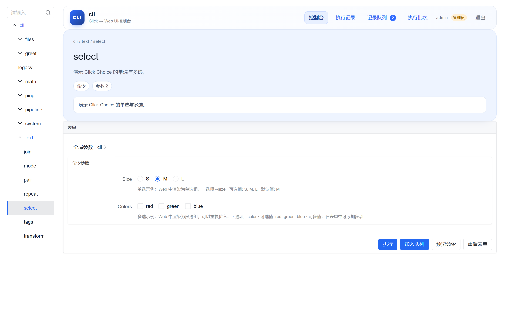
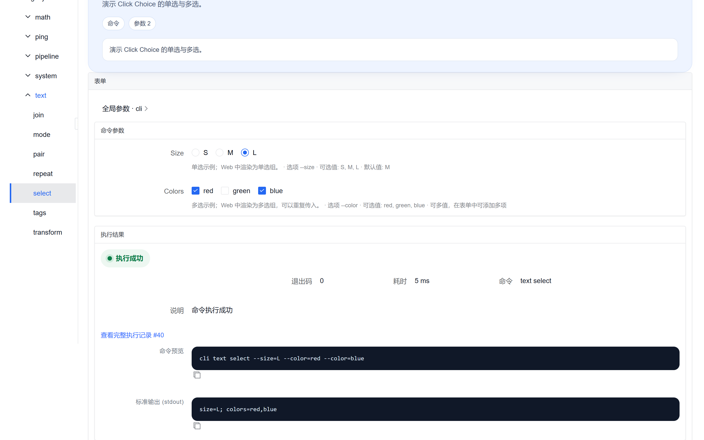
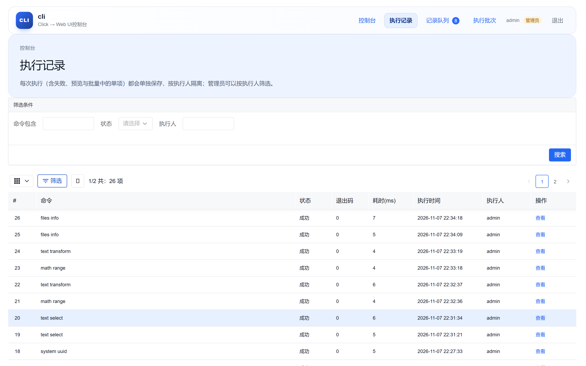
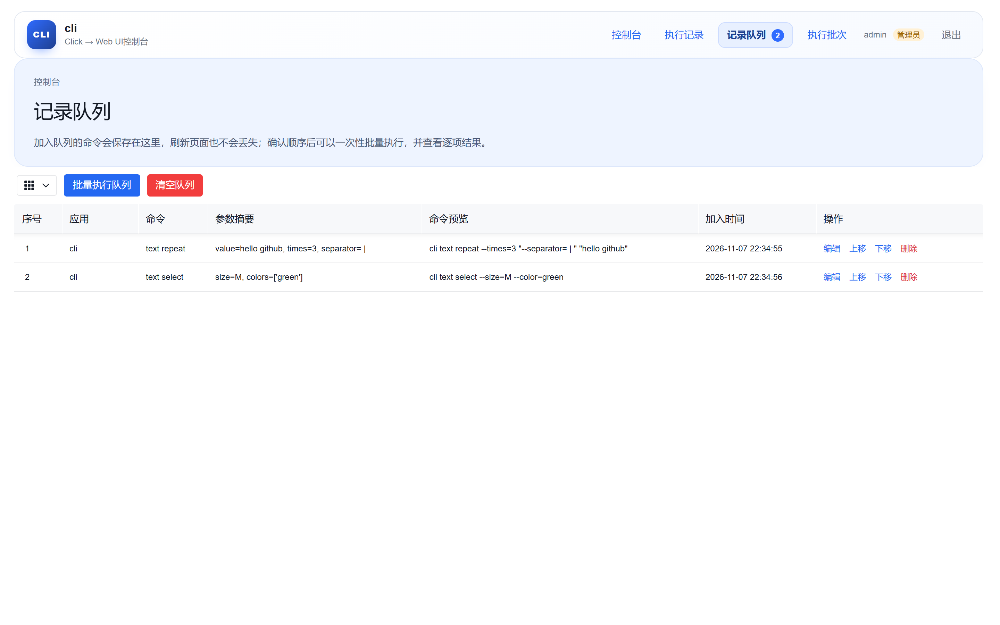
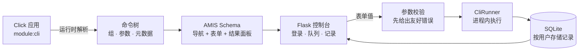

# click-ui

**English documentation:** [README.md](README.md)

**不改一行 Click 代码，把任意 Click CLI 变成专业的 Web 控制台。**

[](https://www.python.org/)
[](https://click.palletsprojects.com/)
[](https://amis.baidu.com/)
[](https://flask.palletsprojects.com/)
[](LICENSE)

`click-ui` 在运行时读取 Click 命令树，用 [AMIS](https://amis.baidu.com/) 渲染成控制台：
左侧导航树、每个命令一张自动生成的表单、按执行人隔离的执行记录、可批量执行的命令队列，
以及跨平台的 Cron / 单次定时执行。

```bash
pip install -e .
cliui serve examples/demo_cli.py:cli
```

接入就这一条命令，原来的 CLI 完全不受影响：

```bash
python examples/demo_cli.py text transform "hello world"
```



---

## 目录

- [为什么需要它](#为什么需要它)
- [核心特性](#核心特性)
- [快速开始](#快速开始)
- [界面截图](#界面截图)
- [工作原理](#工作原理)
- [Click 支持范围](#click-支持范围)
- [配置项](#配置项)
- [命令行参考](#命令行参考)
- [示例](#示例)
- [安全说明](#安全说明)
- [参与开发](#参与开发)
- [许可证](#许可证)

---

## 为什么需要它

内部 CLI 往往是交付运维能力最快的方式，却也是最难共享的方式：运维、测试、客服、产品
不可能都去终端里敲 `--region prod --dry-run`，而每加一个脚本就写一套后台页面也不现实。

`click-ui` 直接复用你已有的 CLI：

- **不用改代码。** 不需要装饰器、注册表或 Click 子类；控制台在启动时读取
  `click.Command` / `Group` / `CommandCollection` 对象。
- **不用再设计界面。** 表单标签、帮助文案、默认值、校验规则全部来自 Click 元数据，
  UI 不会和 CLI 脱节。
- **不用额外部署。** Flask 提供 HTTP 服务，AMIS SDK 随包内置，内网、离线环境都能用，
  不依赖 CDN。

## 核心特性

**忠实还原命令树**

- 由嵌套 `click.Group` 自动生成导航树，支持懒加载组、链式命令组、`CommandCollection`
  多来源、已废弃命令（隐藏命令会加载但不进入导航）。
- 每个命令一张表单，完整使用 Click 元数据：位置参数、选项、默认值、`required`、
  `metavar`、`help`、`envvar`、`prompt`、`hidden`、`deprecated`。
- 执行前可查看**命令预览**，拿到与 Click 完全一致的 argv（含正确转义）。
- 全局参数和命令参数分区展示，组级选项一目了然。

**为不同参数类型渲染合适的控件**

| Click 构造 | 控制台控件 |
| --- | --- |
| `str` / 未声明类型的位置参数 | 文本框 |
| `int`、`float` | 数字框 |
| `click.IntRange` / `click.FloatRange` | 带 `min` / `max` 的数字框 |
| `--flag/--no-flag`、`is_flag` | 开关 |
| 计数选项（`-v`、`-vv`） | 数字框（`min=0`） |
| `click.Choice` | 单选组 |
| `click.Choice(multiple=True)` | 多选组 |
| `multiple=True`、`nargs>1`、`nargs=-1` | 可增删的数组编辑器（固定个数时有长度限制） |
| `click.Tuple` | 数组编辑器 |
| `click.DateTime` | 日期时间选择器 |
| `click.UUID` | 带即时格式校验的文本框 |
| `click.File(mode="r")` | 文件上传（服务端限制大小与路径） |
| `click.File(mode="w")` | 输出路径输入框 |
| `click.Path` | 路径输入框，并按需提供上传回填 |
| `hide_input=True` 的选项 | 密码框（输入遮挡） |

**可审计的执行**

- 每次执行都写入 SQLite：执行人、命令、argv、退出码、耗时、stdout、stderr、异常信息。
- 记录按执行人隔离，管理员可筛选并查看全部；失败、预览、批量中的每一项都单独保存。
- 输出长度、上传大小都有上限，避免异常命令撑爆存储。
- 超过 8 KB 的 stdout/stderr 会自动用 zlib 压缩存储（读取时透明解压）；
  `--retention-days N` 会在启动时清理超过 N 天的旧记录。
- 长任务可勾选“后台执行”：立即返回，记录先标记为“执行中”，完成后自动回填；
  也可用 `GET /api/executions/<id>` 轮询状态与输出。

**队列与批量执行**

- 表单旁固定提供“加入队列”：先收集多条命令、调整顺序，再一次性批量执行并查看逐项结果。
- 队列保存在数据库中，刷新页面不会丢失。
- 每次批量执行都会生成独立批次记录，可在“执行批次”页查看历史与逐项状态。

**定时执行**

- 在命令表单里填写“定时设置”：Cron（5 段）或单次时间，点击**加入定时**即可创建；
  支持 IANA 时区（默认 `Asia/Shanghai`）、常用 Cron 预设与未来 3 次触发预览。
- 生产环境用独立进程 `cliui scheduler --data-dir data`，开发环境用 `cliui serve --scheduler`
  （同进程线程）；两种形态共用同一套调度逻辑与同一个 SQLite 数据库。
- 调度器停机期间错过的触发默认记为 `missed`，可按任务开启“停机补跑一次”。
- 每个触发通过 SQLite 原子抢占，多进程不会重复执行；执行记录标记来源“定时”并关联任务编号。
- 一个计划可以包含多条命令：在命令表单的“追加到已有计划”里选择计划即可追加；
  详情页可查看、移除命令，并可修改计划时间。
- 同一组命令可以“复制为新计划”，再分别设置不同的 Cron / 单次时间。
- 普通用户只能管理自己创建的定时任务，管理员可以查看全部。

**命令总览**

- `/overview` 汇总所有已注册应用的命令树，每个命令附一句话说明；点击命令直接进入对应表单。
- 支持按路径或说明搜索；点击 ★ 收藏命令，“我的收藏 / 最近使用”会以快捷标签固定在顶部。
- 点击左上角的 **CLI** 标记可随时回到命令总览。

**多应用、多账号**

- 一条命令可同时托管多个 Click 应用，用 `name=module:cli` 自定义显示名。
- 账号密码登录，PBKDF2 哈希存储，区分管理员与普通用户；`cliui user` 提供命令行账号管理。
- Flask 会话密钥首次启动时随机生成并持久化，不使用硬编码密钥。

## 快速开始

环境要求：Python 3.9+、Click 8.1+、Flask 3、APScheduler 3.10+（Windows 时区依赖已随 `tzdata` 安装）。

```bash
# 1. 在仓库根目录安装
pip install -e .

# 2. 启动内置示例应用
cliui serve examples/demo_cli.py:cli

# 3. 打开 http://127.0.0.1:5000
```

首次启动会自动创建 `admin` 账号并在终端打印密码。也可以自己指定：

```bash
cliui serve examples/demo_cli.py:cli --admin-password admin123 --open
```

接入自己的应用，只需指向任意可导入的 Click 对象：

```bash
cliui serve mypackage.cli:cli
cliui serve path/to/script.py:cli
cliui serve tools/admin_cli.py:cli name=worker=tools/worker_cli.py:cli
```

最小的接入示例见 [`examples/minimal_cli.py`](examples/minimal_cli.py)：

```bash
cliui serve examples/minimal_cli.py:cli
```

更详细的步骤见 [docs/quickstart.md](docs/quickstart.md)。

## 界面截图

| 命令表单 | 执行结果 |
| --- | --- |
|  |  |

| 执行记录 | 批量执行队列 |
| --- | --- |
|  |  |

## 工作原理



1. **解析**：不执行命令，只遍历 Click 命令树，收集路径、帮助、参数类型、默认值、可选项等信息。
2. **生成**：转换成 AMIS JSON —— 导航树、每个命令的表单、结果面板与记录表格，前端无需再拼 schema。
3. **校验**：先按 Click 语义把表单值转为 argv 并校验，错误直接回填到对应字段。
4. **执行**：用 Click 的 `CliRunner` 在进程内运行，捕获 stdout、stderr、退出码与耗时。
5. **存储**：用户、执行记录、队列与批次统一存放在数据目录的 SQLite 中，按执行人隔离。

更多设计细节见 [docs/architecture.md](docs/architecture.md)。

## Click 支持范围

- `click.Command`、`click.Group`、多层嵌套、`invoke_without_command`
- `click.CommandCollection` 多来源合并
- 自定义 `list_commands` / `get_command` 的组（含懒加载）
- `chain=True` 链式命令组（界面会提示，建议通过队列批量执行）
- `deprecated=True` 与 `hidden=True` 命令（隐藏命令会加载但不进入导航）
- 开启 `allow_extra_args` 的命令（会提示：表单只能表达已声明的参数）
- `context_settings` 中的 `-h/--help` 等别名
- `click.option`、`click.argument`、`click.password_option` 创建的参数
- `multiple`、`nargs`、`Tuple`、`Choice`、`DateTime`、`UUID`、`File`、`Path`、区间、计数选项
- `envvar`、`prompt`、`hide_input`、`is_eager`

## 配置项

### `cliui serve`

| 参数 | 默认值 | 说明 |
| --- | --- | --- |
| `SPEC...` | 必填 | 一个或多个 `module:attr` / `file.py:attr`，可用 `name=spec` 指定别名 |
| `--host` | `127.0.0.1` | 监听地址 |
| `--port` | `5000` | 监听端口 |
| `--data-dir` | `./data` | 数据库、上传文件与密钥目录 |
| `--db-path` | `<data-dir>/cliui.sqlite3` | 自定义 SQLite 路径 |
| `--secret-key` | 自动生成 | Flask 会话签名密钥 |
| `--admin-password` | 自动生成 | 初始 `admin` 账号密码 |
| `--max-output-chars` | `200000` | 单个输出流最多保存的字符数 |
| `--max-upload-mb` | `64` | 上传文件大小上限 |
| `--debug/--no-debug` | 关闭 | Flask 调试模式 |
| `--open/--no-open` | 关闭 | 启动后自动打开浏览器 |
| `--scheduler/--no-scheduler` | 关闭 | 在 Web 进程内启动定时调度线程（开发推荐） |
| `--scheduler-wait-seconds` | `0` | 定时触发等待执行锁的秒数，超时记录为 `skipped` |
| `--retention-days` | `0` | 启动时删除超过 N 天的执行记录；`0` 表示永久保留 |

### 环境变量

| 变量 | 作用 |
| --- | --- |
| `CLIUI_DATA_DIR` | 默认数据目录 |
| `CLIUI_ADMIN_PASSWORD` | 初始管理员密码 |
| `CLIUI_SECRET_KEY` | Flask 会话密钥 |

### `cliui scheduler`

| 参数 | 默认值 | 说明 |
| --- | --- | --- |
| `SPEC...` | 可省略 | 省略时复用 `cliui serve` 保存在数据库里的应用 |
| `--data-dir` | `./data` | 与 Web 控制台共用同一个数据目录 |
| `--db-path` | `<data-dir>/cliui.sqlite3` | 自定义 SQLite 路径 |
| `--max-output-chars` | `200000` | 单条输出最多保存的字符数 |
| `--scheduler-wait-seconds` | `0` | 等待执行锁的秒数，超时记录为 `skipped` |
| `--retention-days` | `0` | 启动时删除超过 N 天的执行记录；`0` 表示永久保留 |

`cliui scheduler` 与 Web 控制台可以同时运行：任务配置保存在 SQLite，触发时用
`next_run_at` 做原子抢占，同一时刻只会有一个进程执行。生产环境推荐把调度器交给
systemd、NSSM 或容器 sidecar 托管。

## 命令行参考

```bash
cliui --version
cliui serve [SPEC...] [options]      # 启动 Web 控制台
cliui scheduler [SPEC...] [options]  # 启动独立定时调度进程
cliui tree SPEC [--json]             # 查看命令树与节点 id
cliui user add <用户名> [密码] [--admin] [--data-dir DIR]
cliui user list [--data-dir DIR]
```

排查解析问题时，可以不开服务直接查看命令树：

```bash
$ cliui tree examples/demo_cli.py:cli
cli [cli]  (/path/to/examples)
- [n0] cli  (组)
  · verbose <count>
  · config <path>
  ...
```

## 示例

- [`examples/demo_cli.py`](examples/demo_cli.py)：覆盖文本、数学、文件、系统、链式命令组、
  组级全局参数、已废弃/隐藏命令、Choice、UUID、密码框等场景的完整演示。
- [`examples/minimal_cli.py`](examples/minimal_cli.py)：最小可用示例，适合直接复制到自己项目。

## 安全说明

- 这是一个**面向内部操作员**的控制台，不是公网应用。对外暴露时请置于 SSO、VPN 或反向代理
  之后，并用只具备必要权限的专用账号运行。
- 上传文件保存在 `<data-dir>/uploads`，执行时以路径引用；上传接口需要登录且有大小上限。
- 表单值经 `shlex` 风格转义后作为 argv 在进程内执行，不经过 shell。
- 执行记录会保存 stdout/stderr，请勿在命令中输出敏感信息。密码框在浏览器中会遮挡显示，
  但密码值与其他参数一样会进入命令预览与执行记录。
- `--admin-password` 可能出现在 shell 历史或进程列表中；服务器上建议使用自动生成的密码
  或 `CLIUI_ADMIN_PASSWORD`。
- 定时任务以创建人的身份写入执行记录，但命令本身仍以服务进程的系统权限运行，请用只具备
  必要权限的专用账号运行控制台与调度器。

## 参与开发

```bash
pip install -e ".[dev]"
python -m pytest -q
```

测试覆盖参数解析、argv 转换、校验、执行、存储、HTTP 路由，以及对生成页面做真实浏览器验证。

项目结构：

```
cliui/
  cli.py            # cliui serve / scheduler / tree / user
  config.py         # 运行时配置
  registry.py       # module:attr 加载
  scheduling.py     # 定时调度（Web 线程与独立进程共用）
  introspect/       # Click → 命令树 / 参数元数据
  schema/           # 命令树 → AMIS JSON、argv 转换
  execute/          # 进程内 CliRunner 执行
  storage/          # SQLite 用户、记录、队列、批次、定时任务
  web/              # Flask 应用、页面、路由、内置 AMIS 资源
examples/           # 示例应用
docs/               # 快速开始、架构说明、截图
tests/              # pytest 测试
```

## 许可证

Apache License 2.0，详见 [LICENSE](LICENSE)；第三方组件声明见
[THIRD_PARTY_NOTICES.md](THIRD_PARTY_NOTICES.md)。

Click 使用 BSD-3-Clause 许可证，AMIS 使用 Apache-2.0 许可证。本项目内置 AMIS SDK 以便离线使用，
未修改上述上游项目。
